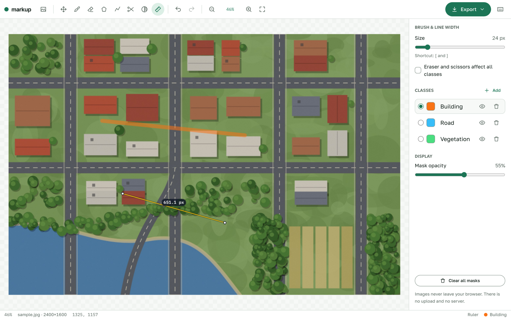
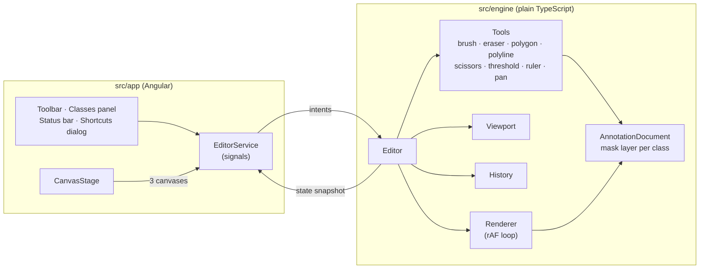

# markup

A browser-based image annotation editor built with Angular signals and the
Canvas API: zoom/pan, brush, eraser, polygons, undo/redo.

<picture>
    <source media="(prefers-color-scheme: dark)" srcset="docs/screenshot-dark.png" />
    
</picture>

Images never leave the browser. There is no upload and no backend.

> **Demo project.** markup is a portfolio piece by
> [Abzal Khairullauly](https://az-way.com). It is a small, self-contained
> take on the kind of annotation tooling I build professionally: a reduced
> feature set on a sample image, written from scratch for this repository.
> It contains no code or data from any employer or client project.

## Features

- **Open an image:** button, drag and drop, or paste from the clipboard.
  PNG, JPEG and WebP up to 50 MB and 8000×8000 px.
- **Viewport:** zoom at the cursor (Ctrl/⌘ + wheel or trackpad pinch), pan
  with Space + drag, middle mouse or the Pan tool, fit to screen and 100%.
- **Tools:** brush and eraser (1–200 px, round preview at real size),
  closed polygon, polyline (open polygon painted at brush width), scissors
  (keep only the mask inside a freehand lasso), threshold (select pixels by
  brightness, with a live preview), ruler (distance in px, Shift snaps to
  45°), pan.
- **Label classes:** add, rename, recolour, delete, show/hide; global mask
  opacity (slider or Shift + wheel).
- **Unsaved work guard:** the browser asks before closing the tab if there
  are edits that were not exported.
- **Undo/redo:** 50 steps. Each step stores only the changed region.
- **Export:** PNG mask per class (white on transparent), a combined colour
  PNG, and JSON:
    ```json
    {
        "image": { "w": 2400, "h": 1600 },
        "classes": [{ "name": "Building", "color": "#f97316" }],
        "masks": { "Building": "<base64 PNG>" }
    }
    ```
- **Keyboard first:** every action has a shortcut and a labelled button.
- **Responsive:** full editor on desktop and tablet; on phones a reduced
  toolbar with Pan, Brush, Eraser and Undo.

## Keyboard shortcuts

| Action                                  | Keys                                            |
| --------------------------------------- | ----------------------------------------------- |
| Pan / Brush / Eraser / Polygon          | `H` / `B` / `E` / `P`                           |
| Polyline / Scissors / Threshold / Ruler | `O` / `S` / `T` / `L`                           |
| Brush size down / up                    | `[` / `]`                                       |
| Eraser, scissors: active class ↔ all    | `Shift` + `E`                                   |
| Polygon: close and fill                 | double-click, `Enter`, or click the first point |
| Polyline: finish                        | double-click, `Enter`                           |
| Polygon, polyline: remove last point    | `Backspace`                                     |
| Threshold: pick brightness / apply      | click a pixel / `Enter`                         |
| Ruler: snap to 45°                      | `Shift` + drag                                  |
| Mask opacity                            | `Shift` + wheel                                 |
| Cancel shape, deselect tool             | `Esc`                                           |
| Zoom in / out                           | `+` / `-`, `Ctrl/⌘` + wheel, pinch              |
| Fit to screen / 100%                    | `0` / `1`                                       |
| Pan                                     | `Space` + drag, middle drag, wheel              |
| Undo                                    | `Ctrl/⌘` + `Z`                                  |
| Redo                                    | `Ctrl/⌘` + `Shift` + `Z`, `Ctrl` + `Y`          |
| Open image                              | `Ctrl/⌘` + `O`                                  |
| Show shortcuts                          | `?`                                             |

## Architecture

The code is split into two layers that only talk in one direction:



- **`src/engine/`** has no Angular imports. An ESLint rule enforces it. The
  engine owns all state and touches nothing in the DOM except the three
  canvases it is given.
- **`src/app/`** wraps the engine in `EditorService`, which mirrors engine
  state into signals (`activeTool`, `activeClass`, `zoom`, `canUndo`,
  `canRedo`, `classes`, …). Components are standalone and `OnPush`; the app
  runs zoneless. Angular never touches pixels.
- **Tools are pluggable.** A tool is one class implementing the `Tool`
  interface (`onPointerDown/Move/Up`, `onKey`, `commit`, `cancel`,
  `cursor`, `renderOverlay`) and gets a narrow `ToolContext`. Adding a tool means writing a file and
  calling `editor.registerTool()`; existing tools don't change.

## How it stays smooth

- **Three stacked canvases.** The image layer is redrawn only when the
  viewport changes. The mask layer composites one offscreen canvas per class.
  The overlay layer (brush outline, polygon in progress) is the only one
  redrawn on every pointer move.
- **One `requestAnimationFrame` loop with dirty flags.** Nothing draws
  outside it. Pointer events only mark layers dirty, so a burst of events
  costs one redraw per frame.
- **Colour-agnostic masks.** Masks are stored as white + alpha and tinted at
  composite time, so recolouring a class is free and never touches undo data.
- **Region-based undo.** Each mask layer keeps a "committed" copy. When a
  stroke ends, only the bounding box it touched is copied out of both canvases
  as the before/after pair. The copies are canvas-to-canvas `drawImage` calls,
  so nothing is read back from the GPU with `getImageData`. History is capped
  at 50 steps and a memory budget.
- **No gaps on fast strokes.** Points between pointer events are interpolated
  with even spacing, and `getCoalescedEvents()` is used where available.
- **Crisp on retina.** Backing stores follow `devicePixelRatio` through a
  `ResizeObserver` (`device-pixel-content-box` where supported).

On a 4000×3000 image at 100% zoom, a 240-event brush stroke holds 16.7 ms
frames (no frame over 16.8 ms), and undo/redo runs in under 10 ms including
the redraw (headless Chromium, M-series MacBook).

## Running locally

Requires Node 24+ and pnpm 10.

```bash
pnpm install
pnpm start        # dev server on http://localhost:4200
pnpm build        # production build in dist/markup/browser
pnpm test         # unit tests (Vitest)
pnpm e2e          # end-to-end tests (Playwright)
pnpm lint         # ESLint + Prettier check
```

The base href is configurable for subfolder hosting:

```bash
BASE_HREF=/lab/markup/ pnpm build:pages
```

Pushes to `main` deploy to GitHub Pages through
`.github/workflows/pages.yml`.

## Design system

The UI uses az-ui, the AZ-Way design system: its colour, spacing and radius
tokens (light and dark themes follow the OS), the `azButton`,
`<az-checkbox>` and `<az-alert>` components, and its self-hosted fonts
(Golos Text, Geologica, IBM Plex Mono). Only the parts markup uses are
copied into `src/vendor/az-ui`. Tailwind maps the semantic tokens to utility
names in `src/styles.css`, so the app chrome never uses raw colours.

## Tech

Angular 22 (standalone, signals, zoneless, new control flow) · TypeScript
strict · Tailwind CSS v4 · az-ui · Vitest · Playwright · ESLint
(angular-eslint) · Prettier. No canvas or drawing libraries.

## Sample image

`public/sample.jpg` is an illustration drawn by
[`scripts/render-sample.mjs`](scripts/render-sample.mjs) (own work,
released under CC0). Regenerate it with `pnpm render-sample`.

## Author

Abzal Khairullauly, [az-way.com](https://az-way.com).

## License

[MIT](LICENSE). The fonts in `src/vendor/az-ui/fonts` are under the SIL Open
Font License 1.1; their licence files are next to them.
